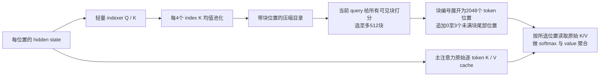

# 从全注意力到 GDN、KDA 与 QSA：到底改了什么

核验截至 2026-11-14。本节依据原论文、作者参考实现及协作推理框架实现。公式统一采用状态矩阵 \(S\in\mathbb R^{d_k\times d_v}\)；部分原始 GDN 论文使用其转置，不能把左右乘混抄。

## 先把三个问题分开

| 问题 | 全注意力 | Gated DeltaNet / Kimi Delta Attention | Qwen Sparse Attention |
| --- | --- | --- | --- |
| 历史以什么形式存在？ | 保留每个位置的 K/V 表示 | 把历史持续写进固定大小的矩阵状态 | 保留原始逐位置 K/V，另建压缩的块索引 |
| 当前 token 怎样读历史？ | 对全部可见位置算相关性，再加权 | 以 query 读取状态矩阵中的关联 | 先用便宜索引选块，再对选中位置的原始 K/V 做注意力 |
| 主要节省什么？ | 高效 kernel 节省中间存储/访存，不改精确注意力数学 | 长历史的状态容量不随序列增长；每步读写固定状态 | 降低昂贵的精读数量与索引常数，不把全部历史压成固定状态 |
| 主要信息风险？ | 表示/打分也可能错；全可达不代表全记对 | 状态容量有限，碰撞、遗忘后不能随时回读被丢掉的原始记录 | 压缩索引漏选；原始记录仍在，但本次精读看不到漏选位置 |

这里的“原始 K/V”指**该层未经过块均值池化的学习表示**，不是未经处理的原文字符，更不是模型额外保存了一份可逐字审计的 PDF。三种机制都不能由结构本身保证事实正确。

## 1. 全注意力为什么擅长回看，也为什么昂贵

省略多头和投影层时，因果注意力在位置 \(t\) 的输出为

\[
p_{tj}=\frac{\exp(q_t^\top k_j/\sqrt{d_k})}{\sum_{u\le t}\exp(q_t^\top k_u/\sqrt{d_k})},\quad
o_t=\sum_{j\le t}p_{tj}v_j.
\]

它把“要找什么”推迟到读取时决定：新问题来了，可以重新给很早的位置打分。KV cache 避免每个生成步重新计算历史 K/V，但每生成一个 token，注意力仍要读取与历史长度有关的 K/V 数据。

对长度 \(N\) 的一层、一个头，仅计 token mixing：prefill/训练的主项是 \(O(N^2 d)\)，生成下一 token 是 \(O(Nd)\)，缓存是 \(O(Nd)\)。FlashAttention 通过分块、融合与在线 softmax 避免显式存完整注意力矩阵，但没有把精确全注意力变成线性计算。GQA/MLA 又可降低 KV 常数，不能与“取消逐 token KV”混为一谈。

研究员例子：把 500 份财报放在上下文中，随后问“某公司 2019 年存货跌价准备金额、单位和相关脚注”。逐位置 KV 使旧记录仍可被直接访问；但模型若没有把公司、年份、指标、单位和脚注正确配对，照样可能选错或回答错。

## 2. Delta rule：不再不断累加，而是改写已有的关联

最简单的线性关联记忆是

\[
S_t=S_{t-1}+k_tv_t^\top,\qquad o_t=S_t^\top q_t.
\]

矩阵 \(S\) 把 key 特征映射到 value 特征。它可持续累加信息，但相似 key 会互相干扰；同一 key 反复写入也可能越积越多。

DeltaNet 改为先用旧状态预测当前 key 应该对应什么，再写入差额：

\[
\hat v_t=S_{t-1}^\top k_t,\quad e_t=v_t-\hat v_t,\quad
S_t=S_{t-1}+\beta_t k_te_t^\top.
\]

等价地，\(S_t=(I-\beta_tk_tk_t^\top)S_{t-1}+\beta_tk_tv_t^\top\)。这里的 \(\beta\) 是写入/纠偏强度；当前 key 的关联被有针对性地覆盖，而不是每次都加一个完整外积。

若 \(\|k_t\|=1\)，则当前 key 的读出变成 \((1-\beta_t)\hat v_t+\beta_tv_t\)。若另一个 key \(u\) 与 \(k_t\) 正交，秩一改写对 \(u\) 的关联没有直接影响；若两者相似，则仍会相互牵连。“精确改写”是沿学习到的向量方向操作，**不是给每条事实分配独立数据库行**。

**自拟算例，不是模型实测：**令一维 key/query 都为 1，旧状态 100，新信息为 120，\(\beta=0.8\)，更新后读出为 116；再看一次 120，读出为 119.2。反复相同信息趋向更新值，而非累加成 220、340。代价是如果它们对应同一个 key，旧值 100 已被覆盖，不能突然要求固定状态把每个历史版本都完整吐出来。真实模型可以学出“公司+年份+版本”的不同 key，但容量与相似度仍有限。

## 3. GDN：在定向改写之前，再加“整体记忆保留率”

Gated DeltaNet 在每个头加入内容相关标量 \(\alpha_t\)，统一写法是

\[
\widetilde S_{t-1}=\alpha_t S_{t-1},\qquad
e_t=v_t-\widetilde S_{t-1}^\top k_t,
\]
\[
S_t=\widetilde S_{t-1}+\beta_tk_te_t^\top,
\qquad o_t=S_t^\top q_t.
\]

它提供两种互补控制：\(\alpha\) 决定已有状态保留多久，\(\beta\) 决定沿当前 key 方向改写多少。\(\alpha\) 接近 0，可以快速清掉上下文切换后的旧状态；接近 1，则主要做 DeltaNet 式定向修改。只有遗忘门、没有 delta 的累加式记忆，难以避免同 key 干扰；只有 delta、没有遗忘门，又不易迅速清空无关旧关联。

但是每头一个 \(\alpha\) 比较粗：为了丢掉某类过时信息，该头其他信息也一起衰减。尤其面对“长期不变的公司身份”和“本轮临时推理草稿”混在同一状态中时，保留与遗忘之间有冲突。

真实模块也不只有这条递推：Q/K/V 先经过短因果卷积与激活，Q/K 常做 L2 归一化；输出再经归一化和输出门。输出门控制读出，不等于上面的遗忘门或写入门。不能看到文献里有三种 gate 就全部翻译成“忘记无用信息”。

**这里的“纠错”不等于模型核验了事实真伪。**误差是 value 向量与当前记忆预测的差，不是公司公告和市场传言之间的真假裁判；推理时更新的是瞬时状态/fast weights，不是把基础模型参数现场微调并永久保存。

作者原式与实现可核对：[GDN 论文，式10](https://arxiv.org/html/2412.06464v3#S3.SS1)、[作者模块](https://github.com/NVlabs/GatedDeltaNet/blob/b53d6d3a161267432a79c1c04af69fa52bddc921/lit_gpt/gated_delta_net.py)、[FLA 标量遗忘参考](https://github.com/fla-org/flash-linear-attention/blob/7a78a662c525a7ac10e5b6b4cdd54d275d141cf2/fla/ops/gated_delta_rule/naive.py#L50)。后者逐步执行“衰减→减去旧关联预测→乘写入强度→写回→查询”。

## 4. KDA：把一个头的总开关细化为每个 key 通道的保留率

Kimi Delta Attention 用向量门替换 GDN 的标量门：

\[
D_t=\operatorname{Diag}(\boldsymbol\alpha_t),\quad
\widetilde S_{t-1}=D_tS_{t-1},\quad
S_t=\widetilde S_{t-1}+\beta_tk_t(v_t-\widetilde S_{t-1}^\top k_t)^\top.
\]

等价形式为

\[
\boxed{S_t=(I-\beta_tk_tk_t^\top)D_tS_{t-1}+\beta_tk_tv_t^\top.}
\]

**顺序不能换。**先按通道遗忘，再根据遗忘后的状态计算残差和改写；一般情况下 \(D_t\) 与 \(I-\beta_tk_tk_t^\top\) 不可交换。KDA 的 \(\beta\) 在原方案里仍是每头标量，并没有因此独立控制 erase 与 write 两套任意通道门。

更细的门允许不同方向有不同记忆寿命。用自拟两通道示意，状态为 \([100,70]^\top\)，门为 \([0.2,1]\)，在不写新值时变成 \([20,70]^\top\)；标量 0.2 会把它变成 \([20,14]^\top\)。实际通道是训练出的隐特征，不能说第一维天然就是“旧预测”、第二维天然就是“已核实事实”。这是说明选择性遗忘的能力边界，不是对神经元语义的实测。

向量门还赋予不同通道不同的内容相关衰减轨迹，因而提供一种动态、乘性的时序信号。这帮助理解为什么 Kimi Linear 的部分全局 MLA 层可以不使用 RoPE，却不等于模型没有任何位置信息；顺序已进入 recurrent transition。是否去 RoPE 是具体模型消融选择，不能据此宣称所有模型删掉位置编码都会更好。

公式与代码：[KDA 原论文式1](https://arxiv.org/html/2510.26692v1#S3)、[FLA 的 KDA 参考](https://github.com/fla-org/flash-linear-attention/blob/7a78a662c525a7ac10e5b6b4cdd54d275d141cf2/fla/ops/kda/naive.py#L59)。代码中 GDN 的 log-decay shape 是 `[B,T,H]`，KDA 是 `[B,T,HV,K]`，广播维度的变化正是逐头标量变成逐 key 通道。

## 5. 固定状态为什么快，为什么还要掺全局注意力

对 GDN/KDA，每头状态容量是 \(d_kd_v\)，不随前缀长度变大。逐 token 更新和读取成本约为 \(O(d_kd_v)\)，整段递推为 \(O(Nd_kd_v)\)。它们没有在每一步重新扫描全部历史 KV，长上下文 decode 的访存优势因而明显。

“线性”是**对序列长度**说的，维度平方项和卷积、投影、MoE、通信仍在。在很短上下文中，固定状态、门控和 kernel 调度常数可能并不便宜；尤其应与 GQA/MLA 等已压缩 KV 的全注意力基线比较，不能拿最朴素 MHA 作为唯一对手。

固定大小、有限精度的状态，不能无损装进任意多条相互独立的历史记录。注意这不是说“只能记住最后几个 token”：重要信息可以保留很久，但记忆存在选择、干扰和覆盖。早先被压掉的信息无法仅靠后来的 query 从该层状态里凭空恢复。

所以混合架构保留全局访问路径：Kimi Linear 的例子是 3 层 KDA 配 1 层 MLA；Qwen 的早期混合路线是 3 层 GDN 配 1 层全局注意力。大部分层便宜地加工状态，少数层重新接触逐位置历史。到了 Flash-Next，原全局层再换为 QSA，在全历史中筛选而非稠密精读所有位置。

混合也不等于整个模型已严格线性：若 1/4 层仍做稠密注意力，长度主项仍含二次项；若换为 QSA，其块索引也仍有长度相关扫描。精确表述应是“大幅减少二次注意力部分和逐层 KV 常数”，而不是“从此上下文无限且免费”。

## 6. 训练为什么没有被 RNN 式逐步递推拖死

直接照递推每 token 启动小运算会浪费 GPU。GDN/KDA 把序列分块，以 WY/UT 等形式把一串秩一变换改写为块内矩阵运算：**块间传状态、块内并行**，让大量工作落在 Tensor Core 友好的矩阵乘法上；生成时再用小的 recurrent kernel 更新一个 token。

这是同一数学递推的不同计算安排，不是训练时一个模型、推理时另一个模型。原 KDA 报告在固定块长 \(C=64\)、头维 \(d_h\) 的约定下给出的 token-mixing FLOPs 主式为

\[
6Nd_h^2+3NCd_h+NC^2,
\]

与全注意力的 \(2N^2d_h\) 对照。注意该式不包含所有投影、MoE 或整网训练反传成本；训练需要保留/重算 activations 与中间状态，**不能把推理状态 O(1) 说成训练显存 O(1)**。

细粒度门也有代价：跨 chunk 累乘衰减、求倒数可能造成数值范围问题，需要 log-space/再分块/高精度路径。KDA 的结构约束把一般 DPLR 的独立低秩向量绑回 key，减少特定中间矩阵与矩阵乘法，并非“门越多、任意矩阵都一样快”。参考：[KDA 算法与复杂度](https://arxiv.org/html/2510.26692v1#S6.SS3)、[作者指向的官方 kernel](https://github.com/fla-org/flash-linear-attention/tree/7a78a662c525a7ac10e5b6b4cdd54d275d141cf2/fla/ops/kda)。

## 7. QSA 的真实流程：压缩目录，保留正文，再去精读

QSA 同一个层里有**两套表示和两条路径**：便宜的 indexer Q/K，以及主注意力的 Q/K/V。不得把二者的 key 混为一个张量。

这是模型内部 attention 的索引，不是互联网搜索引擎，也不是额外接了向量数据库的 RAG。

具体到 Flash-Next：indexer 有 4 个 128 维 query head、1 个共享 key head；把相邻 4 个 **index key** 在 RoPE 前均值池化，再做归一化、给该块赋起始位置的 partial RoPE。先池化再旋转，避免把不同位置旋转相位直接平均。

块打分可简写成

\[
I_{ib}=\sum_{h=1}^{4}\operatorname{ReLU}\!\left(\langle q^I_{ih},\bar k^I_b\rangle\right),\quad
\mathcal B_i=\operatorname{TopK}_{512}(I_{i,:}).
\]

实现可带缩放常数；这是用于排名的 ReLU 多头和，**不是主注意力 softmax**。只有完整可见的块才能参加评分，保证因果性。选出的块展开为具体位置，再追加当前未满块的 0–3 个 token，主注意力精读最多 2051 个位置。

令展开后的集合为 \(\mathcal S_i\)，最终主注意力才计算

\[
o_i=\sum_{j\in\mathcal S_i}
\operatorname{softmax}_{j\in\mathcal S_i}
\left(q_i^\top k_j/\sqrt{d_k}\right)v_j.
\]

**精读里的 \(k_j,v_j\) 没有被四合一。**目录摘要只决定去哪找；选中后可以区分同块的公司名、年份、金额或单位等不同位置。但漏选整个块时，本次精读就看不到其中所有 token。

研究员例子：把几百页资料排成许多四位置小格，用摘要目录先找与“存货减值”有关的格子，再取回该格子里的细节。若目录被周围文本冲淡、错过一处小脚注，金额仍在主 KV 里，却未进入此次精读。这与 GDN 被遗忘后只剩状态不同：QSA 的另一 query/另一层仍可能重新选中该位置；也不能说整网只能读 2051 个历史位置，因为不同层、不同 query 可选择不同集合。

一手核验：[QSA 论文式12–20](https://arxiv.org/html/2608.30320v1#S2.SS1.SSS2)、[SGLang 协作实现说明](https://www.lmsys.org/blog/2026-08-26-qwen-flash-next/)、[池化/索引展开/原始 KV 精读参考代码](https://github.com/sgl-project/sglang/blob/8c7ec05287904d88854d9fb5bcbe1a5181282b5e/python/sglang/srt/layers/attention/qsa/kernel.py)、[QSA indexer](https://github.com/sgl-project/sglang/blob/8c7ec05287904d88854d9fb5bcbe1a5181282b5e/python/sglang/srt/layers/attention/qsa/qsa_indexer.py)。代码 `average_pool_qsa_keys` 用 FP32 平均；最终参考精读按 `token_slots` 取 K/V，再计算 softmax。

## 8. QSA 的索引不是天然会选：要学，而且预算会丢信息

QSA 在 continued pretraining 中加入。先用稠密主注意力作 teacher，训练轻量 indexer：把 teacher 的多个头分布聚合，再对每个块内的 token 分数做 **max pooling**、归一化，以 KL 蒸馏块级重要性；随后切换稀疏注意力、联合适配 backbone 与 indexer。

这里两种 pooling 要区别：**index key 用平均池化；teacher 的重要性目标用最大池化。**后者尽量保住块里少数高相关 token，避免教师标签被平均冲淡；它降低漏选风险，但不提供理论上零漏选保证。

Top-k 是硬选择，重要性排序、块长、token 预算与训练分布一起决定质量。若一项任务要求汇总远超 2048 个分散证据位置，一次注意力调用不能同时精读所有位置；多层传递、反复调用和外部检索可缓解，但不能拿少数 needle 命中率替代复杂跨文档研究。

## 9. 不要把 QSA 的缓存和复杂度写错

| 每层/每头量级；仅 token mixing | Prefill 主项 | 下一 token | 推理历史存储 |
| --- | --- | --- | --- |
| 稠密注意力 | \(O(N^2d)\) | \(O(Nd)\) | \(O(Nd)\) 的 K/V |
| GDN/KDA | 固定维度与 chunk 长下对 N 线性 | \(O(d_kd_v)\) | \(O(d_kd_v)\) 状态，外加固定短卷积状态 |
| QSA | 约 \(O(N^2H_Id_I/r)+O(NKd)\)，另有 top-k 成本 | 约 \(O((N/r)H_Id_I)+O(Kd)\) | 原始 K/V 仍 \(O(Nd)\)，另加 \(O((N/r)d_I)\) 索引 |

其中 \(r=4\)、\(K=2048\) 是该模型配置，\(H_I,d_I\) 是小 indexer 的头数与维度。固定 \(r\) 时，索引 prefill 的渐近阶仍是二次，不是严格 \(O(N)\)；decode 还要扫大约 \(N/4\) 个小索引 key，也不是对历史长度完全无关。

QSA **没有因只读 2K 个位置，就把其他原始 KV 全删掉**。单个 QSA 层甚至多了一份小索引缓存。Flash-Next 整体缓存节约的重要来源，是 48 层里 36 层为固定状态 GDN，只有 12 层保存增长的逐 token K/V；这仍须与具体 GQA/MLA 基线、精度、batch 和实现比较。

硬件上，QSA 节省昂贵的主 KV 读取，但增加索引扫描、top-k、块展开、非连续 gather 与元数据成本；需要融合 kernel、布局设计和流水重叠才可兑现速度。SGLang 把索引与主 Q/K/V 投影放不同 CUDA stream 重叠执行，也给 CUDA graph、KV 池与分布式 gather 做了专门路径。小输入、低 batch、不同 GPU 上未必按长上下文 kernel 的倍数加速。[实际调度代码](https://github.com/sgl-project/sglang/blob/8c7ec05287904d88854d9fb5bcbe1a5181282b5e/python/sglang/srt/models/qwen4_exp.py#L2015)。

## 10. 评价模型时，怎样把“新架构”变成可验证问题

- **找回能力**：单 needle 之外，测多公司同名指标、多年份改口径、互相冲突披露、稀疏脚注、跨文档 join、逐字引文与单位；分别改变证据位置、干扰量和间隔。模型能接收 1M 不等于 1M 上可靠做完这些任务。
- **状态更新**：反复给相同事实、按同一 key 修订数值、切换任务后重新查询旧记录，观察覆盖、过度保留与无关信息遗忘。必须对比外部 RAG/文件工具是否启用。
- **成本**：固定硬件、精度、batch、上下文/输出长度、缓存命中率，分别测 TTFT、decode TPOT、显存和每成功任务费用。kernel 吞吐、整网时延和大 batch 总吞吐不能互换。
- **误差来源**：KV 量化、状态数值精度、索引漏选、主注意力打分、工具执行与最终推理分别定位；“架构更省”不能证明数据更准。
- **因果解释**：在相同训练预算、参数、数据、后训练、harness 下做消融，才更接近识别注意力本身的贡献。某代模型总榜分高，可能同时受参数、数据、RL、工具和评测预算推动。

一个值得直接展示的反宣传例子：Qwen 官方 QSA 消融里，1M 的 8-needle MRCR 从 20.71 提到 26.44，结构改动是有效进步，但也清楚说明“1M 可用”远非“百万上下文所有历史任意精确召回”。全注意力基线同样低，证明保存原始 KV 是可达性条件，不是可靠性的充分条件。[原表3](https://arxiv.org/html/2608.30320v1#S2.SS1.SSS2)。

## 技术沿革必须写清

- Gated DeltaNet 初稿 **2024-12-09**，ICLR 2025；不是 2026 Qwen 首创。[论文提交历史](https://arxiv.org/abs/2412.06464)。
- Kimi Linear/KDA **2025-10-30**；2026 产品如果使用或扩展它，属于继承与工程规模化，不能把原式记到 2026 首创栏。[原报告](https://arxiv.org/abs/2510.26692)。
- Qwen3-Next 已在 **2025-09** 采用 GDN 与 attention 混合路线；3.5 及后续沿用并放大。Flash-Next 的 QSA 是在既有 GDN 混合基底上进一步减少全球层精读/索引成本，并非从无注意力突然变出线性模型。[官方系列 News](https://github.com/QwenLM/Qwen3.8)、[Flash-Next 原报告](https://arxiv.org/abs/2608.30320)。

本次核验了数学与实际参考代码路径；没有在 GPU 上复现实验、没有声称独立确认官方全部效率或精度成绩。
