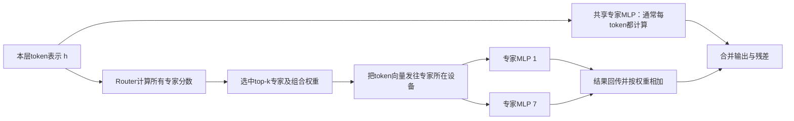
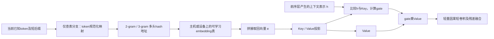

# MoE 与条件记忆：把“选择计算”和“选择查表”拆开理解

核验截至2026-11-14。这里讲机制，不做模型排名。证据分为作者论文、官方演示代码、推理框架实现，以及明确标作教学假设的算术。代码读通不等于完成训练复现；没有把某篇研究自动等同所有商业API的实现。

## 1. 先回答：加参数，究竟加的是什么？

| 变化 | 每个token多做什么 | 增加的主要资源 | 不能直接推出什么 |
| --- | --- | --- | --- |
| Dense FFN加宽/加深 | 执行更多矩阵计算 | FLOPs、权重、激活、带宽 | 效果必然按参数量增长 |
| MoE增加专家数E、保持每token选k不变 | 从更大的参数库里选择少量MLP执行 | 总权重、router、专家分布和通信；专家计算不按E同比增长 | 总参数越大，每token算力同比越大；只需装入激活参数就能部署 |
| MoE提高k | 同一token执行更多专家并组合 | FLOPs、激活搬运、通信 | 不重新训练/校准也会单调变强 |
| 增大n-gram条件记忆表 | 仍只取少量向量，表中可学习槽位变多 | 参数存储、随机访问、训练更新、CPU↔GPU链路 | 新增51B查表参数等于新增51B矩阵计算；可以免费无限扩容 |
| 增大KV cache | 保存更多本次请求的历史中间状态 | 随序列/并发变化的运行时内存 | 模型学到了更多固定知识；模型参数变多 |

“计算容量”和“查表容量”都能扩展模型表达能力，但资源账不同。MoE是**conditional computation：挑哪些函数来算**；Engram/n-gram embedding是**conditional memory：挑哪些训练过的向量来读**。后者仍需要门控、投影、卷积，绝非零计算。稀疏MoE已在2017年论文中系统展示，共享专家/细粒度专家见2024年DeepSeekMoE；不能全部算作2026原创。[稀疏MoE论文](https://arxiv.org/abs/1701.06538)、[DeepSeekMoE](https://arxiv.org/html/2401.06066v1)

## 2. MoE的一次前向：router不是一个能“理解行业”的总经理

一个专家通常是某层里的FFN/MLP参数块，并非一套完整模型；一篇财报的不同token、不同层可以走不同专家组合。训练可能产生某些偏好，但不能仅凭名称宣称“这个专家只懂金融”。

教学简式（省略残差和具体归一化）：

`MoE(h) = Shared(h) + Σ[i∈TopK(router(h))] gate_i(h) × Expert_i(h)`

1. attention等前序运算先形成当前层的hidden state `h`。
2. router通常是一个轻量线性投影再经softmax或sigmoid，算出token与各专家的匹配分数。
3. 取top-k，将token向量分派到选中专家；专家执行矩阵运算。
4. 按gate把输出相加。共享专家可承担公共模式，避免每个路由专家重复学习同样的基础变换；有些实现再给共享通路加gate，不能把一种做法套到所有模型。
5. 接回残差流，进入下一子层。下层可重新路由。

可直接对照DeepSeek官方代码：`Gate.forward`保留原始匹配分数，用偏置后的分数决定选择，再用原始分数产生混合权重；`MoE.forward`只运行本设备被命中的专家，另算共享MLP并归并结果。**官方教学推理代码这里采用all_reduce合并，不等于生产专家并行一定采用同样通信拓扑。** [固定版本代码：Gate/MoE](https://github.com/deepseek-ai/DeepSeek-V3/blob/9b4e9788e4a3a731f7567338ed15d3ec549ce03b/inference/model.py#L535)

### 为什么负载均衡影响模型质量，也影响吞吐

若多数token挤进几个专家，会出现热门专家过载、其他专家缺训练信号，设备相互等候。常见方法是用辅助损失约束专家使用分布；约束过强又会干扰任务本身学习。[Switch Transformer](https://arxiv.org/abs/2101.03961)

DeepSeek-V3的思路是反馈调路由偏置：过载专家的选择偏置往下调，欠载专家往上调；偏置用于选谁，混合输出仍按原匹配分数。它仍保留了很小的序列级辅助项，所以“auxiliary-loss-free”不应解释成训练中绝无任何均衡辅助损失；节点受限路由也在减少跨节点分散。**这是2024/2025已公开路线，不是2026首次发明。** [V3 §2.1.2与§4.5](https://arxiv.org/html/2412.19437v2#S2.SS1.SSS2)

训练时的均衡也不保证推理时每批都均衡：真实业务域、batch大小及分布会变，生产系统还可能复制热门专家、动态调整部署与通信。这些是运行时优化，不必然意味着模型新架构。

## 3. 总参、激活参数、权重驻留：用一笔账打通

只看一个MoE层的路由专家部分，设 `E`个同宽专家，每个`P_e`参数，每token选择`k`个：

`全部路由专家参数 = E × P_e`

`单token选中专家参数 = k × P_e`

后者可粗看专家矩阵计算的规模，却不是整个模型的总显存或完整FLOPs公式。还需另算attention、共享专家、router、embedding/output head、层数、序列长度及量化格式；模型卡“激活参数”也有具体统计约定。

**教学例**：64个专家，每个100M参数；每token选2个，另有一个100M共享专家。总专家权重6.5B，单token执行约300M专家参数。若全部BF16保存，裸专家权重约13GB；不能说“激活300M，所以只需0.6GB显存”。未被当前token选中的权重依然属于模型，需要在HBM、主存或其他存储层可取得。

batch会改变实际工作集。在“不同token独立、均匀选专家”的教学假设下，B个token预计触及专家数为：

`E × [1 − (1 − k/E)^B]`

64专家、top-2、32个token，约触及40.8个；64个token约55.6个。这不是实际router预测，只说明**每token稀疏，不代表整批只读两个专家**。大batch把许多token聚成专家GEMM有利于利用率，也会增加工作集；小batch和长尾专家可能形成许多很小的GEMM。

专家并行通常把专家权重分散驻留到设备上，传的是token表示和专家输出，而非每次把所有专家权重搬来搬去。粗略忽略去重、分组及拓扑，dispatch与combine流量随 `B × k × hidden_dimension × 每元素字节` 增长；通信等待可能抵消FLOPs节省。专家权重卸载也能做，但router依赖当前层`h`，通常不像token确定地址的查表那样，可在前向开始前精确知道所有要取的专家。

## 4. Engram：熟悉的局部组合，先查一份可学习的“速记”

Engram读取的是**训练参数中的向量**，不是网上文章、用户历史数据库或可直接展示的事实条目。普通推理时表固定；训练或微调可以更新。静态的是表与地址规则，**最终采用多少是上下文相关的**。

以三个示意token `New / York / City` 为例：到City这个位置，查表分支可以用后缀`York City`及`New York City`分别生成地址。**这是示意分词，不保证任何实际tokenizer恰好如此切分。** 同样的局部token后缀会取到同组参数向量，而前面谈城市、球队或同名实体的上下文不同，会改变gate。

### 对照官方demo，把步骤逐一读出来

以下基于[官方demo固定版本](https://github.com/deepseek-ai/Engram/blob/fb7f84a21f91223715394a33a1dc24bbfb7f788e/engram_demo_v1.py)，不引用生产模型的精确超参。

1. `CompressedTokenizer`预先建立原token ID→规范ID映射，使用Unicode、大小写、空白等规范化合并部分表面变体；**没有改动主干原始token，也不是把所有同义词压成一个词**。
2. `NgramHashMapping`把每个位置结束的短n-gram经乘法/XOR及取模映射到若干表。多个hash头是对冲撞桶的多份索引，**不是attention的多个Q/K/V头**。有碰撞仍可能共享部分向量，不能说无碰撞精确数据库。
3. `MultiHeadEmbedding`取出各阶各头的一行并拼接为`e`，而非扫描整张表。demo中2/3-gram、各8头，每头64维，共1024维，只是演示配置。
4. `Engram.forward`从`e`投影出Key和Value，从当前上下文`h`取Query；做归一化相似度和sigmoid门控。多分支共享查表/Value，Key与gate按分支变化，避免每条分支都复制整个巨大表。
5. 门控后的Value经因果depthwise短卷积完善局部交互，再与门控Value相加，最后注入主干残差。

示意公式（单分支）：

`z[n,j,t] = hash[n,j](normalized suffix tokens)`

`e_t = concat[n,j](EmbeddingTable[n,j][z[n,j,t]])`

`s_t = dot(RMSNorm(h_t), RMSNorm(W_k e_t)) / sqrt(d)`

`a_t = sigmoid(f(s_t));  u_t = a_t × (W_v e_t)`

`memory_output_t = u_t + CausalShortConv(u)_t`

论文简式用`f(s)=s`；demo里额外有保号平方根变换（先`abs().clamp_min().sqrt()`再乘符号），因此这里显式保留`f`。若逐行复现，必须以指定版本实现为准，不能把以上简式当所有实现数值完全等价。

最重要的代码边界：demo开头说明Attention、MoE和复杂连接机制被省略或mock，尚需生产kernel和分布式优化。它能解释数据流，**不能证明生产吞吐、训练结果或某商业端点已按这份demo部署**。

### 为什么能预取，为什么又不是“零时间记忆”

查表地址只依赖已经知道的token，故可在模型到达记忆层之前，把所需小向量取来，与前序层计算重叠。prefill时整段prompt已知；decode时只能在当前输入token确定后预取相应内容，**不能提前知道还没生成的未来token**。

作者在H800、512条序列、长度100–1024、4B/8B dense主干、第二层插入100B表的实验中，主存卸载吞吐下降约1.9%/2.8%。这是特定吞吐实验，且刻意未混入MoE专家并行，不能外推单用户延迟、任意CPU、所有长上下文或所有batch。论文的`O(1)`指固定n-gram阶数/头数下地址查找不随整张表容量线性扫描，不是端到端推理耗时永远不变。[Engram论文§2、§6.4](https://arxiv.org/html/2601.07372v1)

## 5. Qwen的n-gram扩容：同一思想族，不是每个细节都照抄

Qwen3.8-Flash-Next公布**约125B主干+51B n-gram表，6B每token激活**。不能把176B全部称为矩阵计算主干，也不能把51B查表参数解释成51B每token全部执行。[官方仓库](https://github.com/QwenLM/Qwen3.8-Flash-Next)

论文§2.3明确使用多头hash及上下文门控，采用一个记忆注入层，并选择Layer2为前一层计算留下预取窗口；它尝试token规范化等变体，但在该训练配方下未得稳定收益。**不能把Engram的规范化必选项套到Qwen。** 还发现表更大时loss持续下降，而下游准确率有饱和或波动；同参数预算下增加记忆会挤占其他容量，最优分配不是“全部给表”。[Qwen技术报告§2.3](https://arxiv.org/html/2608.30320v1#S2.SS3)

作为实现交叉核对，SGLang中该架构使用内部名`qwen4_exp`；它服务Qwen3.8-Flash-Next并不表示所有Qwen4产品已经采用相同权重/配置。以下链接固定到2026-11-13代码：

- `Qwen4ExpNGramEmbedding`：生成多头n-gram地址、管理表和分片。
- `Qwen4ExpPLELayer.start_prefetch`：在独立stream中取行；到需要融合时`wait_stream`等待，**没有取完仍然会阻塞**。
- `Qwen4ExpPinnedHostEmbedding`与host-table模块：支持pinned主存，以及特定条件的文件/mmap方案。GPU可以通过UVA直接读host表；“在CPU内存”不必然等于“CPU核执行全部查表”。
- 这份实现也能看到Key/Value投影、归一化gate和短卷积，不是简单把一个字典向量无条件加上去。

[模型实现](https://github.com/sgl-project/sglang/blob/8c7ec05287904d88854d9fb5bcbe1a5181282b5e/python/sglang/srt/models/qwen4_exp.py#L620)、[host表实现](https://github.com/sgl-project/sglang/blob/8c7ec05287904d88854d9fb5bcbe1a5181282b5e/python/sglang/srt/models/qwen4_exp_ple_table.py)

## 6. 主存和互联的账：省HBM，瓶颈可能转移

先算**容量**：51B表若全部BF16，理想裸权重约102GB；FP8约51GB，另有scale、元数据和缓冲。若主干125B也全部BF16，另需约250GB裸权重。整模型约352GB这个算术不能被“每token激活6B≈12GB”替代。可量化、分片、卸载，但每项都有工程条件和精度代价。

再算**每步交通量**。教学简式：

`读取量 ≈ 同步处理token数 B × 记忆层数 L_m × 每token取出的总维数 d_mem × 每元素字节 b`

重复行去重/缓存可降低交通量，随机访问的缓存行、页面与同步开销又可能放大实际成本。用上文demo维度作纯教学：B=512、两个记忆层、d_mem=1024、BF16=2字节，约2MiB；若有效链路32GB/s，仅理想传输约65.5微秒，**尚未计随机读延迟、hash、gather、投影、同步和拥塞**。这不是任何发布模型的实测。

可隐藏的部分由时间窗决定：

`未隐藏等待 ≈ max(0, 查表/搬运耗时 − 可重叠的前序计算耗时)`

这是排程直觉，不是可直接拿来预测生产SLA的完整模型。小batch时固定延迟占比可能较大；大batch/高并发时随机主存带宽、PCIe/C2C和NUMA跨socket通路可能拥塞。低精度主干越快，原来能隐藏的搬运也可能重新暴露。

需要同时测：主存实际随机访问带宽、GPU↔CPU有效带宽、hot-row命中、p50/p95查表等待、prefill/decoding分段吞吐、并发下尾时延，以及质量/输出token变化。分离GPU+主存平台上可释放HBM；统一内存平台把表换到“CPU”未必释放物理总容量。SGLang的host-table实现明确讨论了这种差别。[host存储设计](https://github.com/sgl-project/sglang/blob/8c7ec05287904d88854d9fb5bcbe1a5181282b5e/python/sglang/srt/models/qwen4_exp_ple_table.py)

因此可形成产业链研究假设：便宜DRAM、更快CPU-GPU互联、NUMA/预取/缓存软件的价值可能上升；但不能从51B表直接推算新增服务器订单。实际量化、共享缓存、负载、复用与需求量都要进入模型。

## 7. 五种叫“记忆”的东西，生命周期完全不同

| 对象 | 存的是什么 / 怎么读取 | 生命周期 | 和Engram的关键区别 |
| --- | --- | --- | --- |
| Engram / n-gram表 | 训练好的参数向量；局部token确定hash地址，hidden state决定融合强度 | 多请求共享，普通推理不更新 | 不保证人可读、可溯源；不是新用户事实自动入库 |
| RAG | 文档/片段索引；用查询和retriever找到支持材料，再供生成 | 外部知识库可单独更新 | 不必改模型参数，可保留来源；检索与文档质量另成瓶颈 |
| KV cache | 本轮历史token在各层形成的Key/Value或压缩表示 | 请求/会话内，或有效前缀复用 | 不增加学到的固定参数；内容由具体上下文动态产生 |
| preserve_thinking | 把已生成的思考文本保留/回传进后续请求或模板 | 显式对话历史，受上下文容量约束 | 是上下文组织策略，不是权重存储，也不保证跨会话永久记忆 |
| n-gram投机解码 | 从已知序列重复模式提议接下来若干token，目标模型验证 | 本次生成的加速状态 | 同样叫n-gram，却是起草token的加速算法，不是增加训练记忆表 |

RAG的经典形式包含参数生成器和外部检索索引；KV分页则处理动态运行时缓存；两者的来源与可更新性不同。[RAG原论文](https://arxiv.org/abs/2005.11401)、[PagedAttention](https://arxiv.org/abs/2309.06180)

Qwen官方模型卡解释`preserve_thinking`保留历史reasoning blocks供后续输入；可能减少重想、改善前缀缓存复用，也会保留更多上下文。它不是把思考写进Engram，更不意味着节省所有情景的token。DeepSeek官方工具思考接口则要求按其协议回传`reasoning_content`，不能把一个平台的参数名和默认行为泛化到另一平台。[Qwen模型卡](https://huggingface.co/Qwen/Qwen3.8-27B-FP8/blob/main/README.md)、[DeepSeek工具思考协议](https://api-docs.deepseek.com/guides/thinking_mode/)

## 8. 2026的重要性，应放在正确历史线上

- 稀疏专家与路由不是2026新概念；2017稀疏门控MoE、2021 Switch、2024 DeepSeekMoE/V3已提供关键基础。2026值得研究的是每个模型如何组合、扩规模、训稳，并让它在实际硬件上划算。
- hash embedding也不是2026首创，2017已有明确论文。Google在2025 Gemma3n已探索PLE等参数分层/卸载；不能因为今天叫“条件记忆”，就把查表、分层存储的一切都算新发明。[2017 Hash Embeddings](https://arxiv.org/abs/1709.03933)、[Google Gemma3n开发说明](https://developers.googleblog.com/en/introducing-gemma-3n-developer-guide/)
- Engram的重要推进是把局部参数记忆作为与MoE互补的容量轴，连同门控、分配和系统实验一起研究；Qwen进一步在其配方中做位置/容量/准确率消融，并接入混合注意力、残差和优化器整体设计。这不是“又多加了一张表，所以逻辑能力无限提高”。
- 最该问的反事实：在总参数、训练FLOPs、训练token、后训练、推理预算、硬件与质量门槛明确后，这种容量分配是否仍优于把同样资源给更多专家、更宽主干或更长训练？等FLOPs也不等于等美元成本，后者还包含存储/通信与利用率。

## 读代码的定位清单

1. DeepSeek-V3 `inference/model.py`：`Gate`约535行、路由选择576–598行、`MoE`约636行、共享专家与结果合并约681–693行。
2. Engram `engram_demo_v1.py`：文件头免责声明；`CompressedTokenizer`约60行；`NgramHashMapping`约188行；`MultiHeadEmbedding`约305行；`Engram.forward`约358–378行。
3. SGLang `qwen4_exp.py`：`Qwen4ExpNGramEmbedding`约620行；`Qwen4ExpPLELayer`约1105行；`start_prefetch`约1385行；融合gate约1479–1494行。`qwen4_exp_ple_table.py`说明pinned/file两种host存储后端。

本节未运行这些大型模型或付费API，也未复跑吞吐/训练实验；机制解释来自已读论文与代码，教学数值已独立算术核对。
