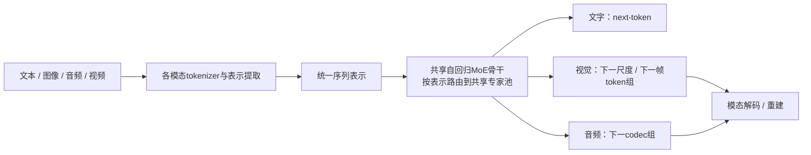
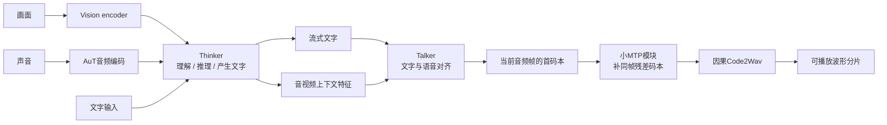
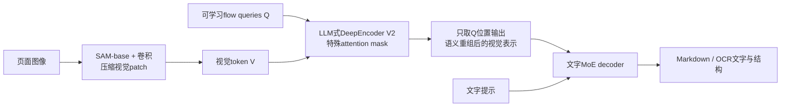
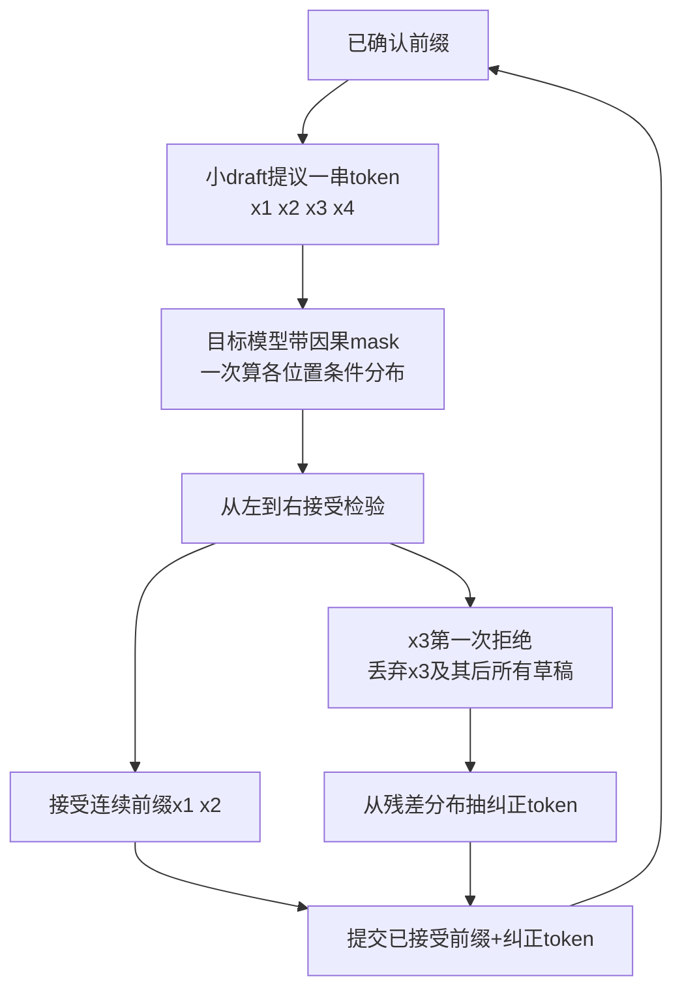

# 多模态与快速解码：从输入路径到系统条件

核验截止2026-11-14。以下结构图是依据原论文/代码重绘的教学简图，省略norm、残差、分布式并行等细节。2024/2025论文仅作技术背景，不算2026首发。评测与速度数字均注明厂商/作者口径，未实际复测。

## 1. 先把三条不同的轴拆开

| 要问的问题 | 能回答什么 | 不能自动推断什么 |
| --- | --- | --- |
| 输入怎样进入模型？视觉encoder、音频encoder、projector分别在哪？ | 原始信号怎样变为可供语言骨干处理的向量 | 有encoder不等于训练晚融合；没有独立大encoder也不等于视觉更强 |
| 多模态何时参与训练？只在文本预训练后连接，还是预训练早期就联合？ | 模态对齐与知识共同学习的程度 | early fusion不等于删除所有模态专用部件 |
| 输出究竟是什么？文字、音频codec、图像/视频token，还是工具调用？ | 模型本体能理解或生成哪种模态 | 能看视频、能调用视频工具，不等于本体直接生成视频 |

最直接的反例是[Qwen3.5官方卡](https://huggingface.co/Qwen/Qwen3.5-35B-A3B-Base)：同时写明“early fusion training”和“Causal Language Model with Vision Encoder”。前者说训练策略，后者说结构，两者不矛盾。不能把“编码器+投影”和“早融合”硬画成互斥两派。

## 2. 编码器+投影器：给语言骨干接入视觉，不是先把图全翻成文字


教学上可把投影器看作维度转换：视觉特征为 `V ∈ R^(Nv×dv)`，线性投影近似 `Z=VW ∈ R^(Nv×dmodel)`；实际adapter可含MLP、attention或更复杂压缩。输出是连续向量，不必对应“猫”“金额”等人能直接读出的词。文本与视觉向量可进入同一骨干，但位置编码、mask、采样率仍可能不同。

代价主要来自视觉token数与信息压缩：高分辨率、多裁剪、多帧通常保留更多细节，也增加预填充计算、KV或循环状态处理以及服务延迟。过度压缩容易损失小字、相近符号和细粒度时间事件。模型的“能看”还应分成内容识别、文档结构、图表推理、空间定位、跨帧追踪来测。

这是通用教学抽象；Qwen3.8-Omni的原文确实列视觉编码器、普通AuT与Spatial AuT三条感知路径，再由adapter投影到Thinker共享空间；因此“统一表示”不意味着原始像素与波形直接共用文字分词器。[Qwen3.8-Omni §2.1](https://arxiv.org/html/2609.25611v1#S2.SS1)

## 3. 统一理解与生成：以ERNIE5.0说明“统一”究竟统一了什么



ERNIE5.0报告将文字NTP、视觉NFSP和音频NCP归入Next-Group-of-Tokens框架，并从头联合训练多模态。共享的是序列建模骨干与训练组织；图像生成可先粗尺度后细尺度、视频再沿时间预测帧。专家路由不靠预设“音频专用编号”硬分区，但专家仍可能从数据中学出模态偏好。[ERNIE5.0 §2.1](https://arxiv.org/html/2602.04705v1#S2.SS1)

这个例子也能反驳“统一模型没有专用模块”：报告的理解路径仍保留CNN+ViT双路特征和attention patch merger；生成路径使用量化token。理解更怕细节被压丢，生成还需保留可重建结构，两种需求没有因为统一骨干就消失。[ERNIE5.0 §2.2](https://arxiv.org/html/2602.04705v1#S2.SS2)

研究时看三件事：不同模态是否共享并更新骨干；理解与生成如何避免信息表示冲突；同等训练算力/数据下是否存在模态间性能牺牲。不能用公司自称“原生”代替这三个问题，也不能预设统一路线必然胜过模块化路线。

## 4. Thinker–Talker：理解内容与实时发声分工



“Thinker”是功能分工，不保证每次都执行显式长思维链；“Talker”也不是简单把一整篇已完成答案交给外部TTS。它可边接收文字与上下文、边生成语音。Qwen3系列已提供这条结构；2026年3.5-Omni进一步引入ARIA，把文字与语音单位自适应对齐后交错，缓解不同语言分词速度不匹配引起的漏词、读错数字和不自然韵律。[Qwen3.5-Omni §2.1、2.5](https://arxiv.org/html/2604.15804v1#S2)

音频码本可以类比一个80毫秒声音片段的分层描述：首层承载较粗语义，残差层补音色、韵律等声学细节。这里MTP补的是**同一个时间帧的多个码本**，不是先猜未来几个文字再由大模型拒绝采样验收。2026年Qwen3-TTS-12Hz采用12.5Hz、16层码本与轻量因果ConvNet，能单帧启动；25Hz版本则用单码本与分块DiT重建，不能把两种型号的结构混写。[Qwen3-TTS §2、3.1](https://arxiv.org/html/2601.15621v1#S3.SS1)

“流式”至少要拆输入分块、Thinker预填充、文字生成、Talker发声、客户端播放缓冲五段。因果Code2Wav只依赖左侧已知片段，少等待未来块，适合低首包延迟；代价是未来韵律信息更少，对对齐、停顿和长句自然度提出更高要求。这是因果性带来的工程取舍，不是声学质量自动无损。

Qwen3.8-Omni报告继续使用该路线，Talker增加24→48kHz重建，输入侧增加Spatial AuT保留多通道相位/幅度线索；这才是可以定位到部件的架构变化。Qwen-MM-Plugins、Live-Harness里的异步工具、子agent与长期记忆属于系统编排，不能画成MoE层内部新结构。[Qwen3.8-Omni §2.1、7](https://arxiv.org/html/2609.25611v1#S7)、[开源Live-Harness](https://github.com/QwenLM/Qwen-Live-Harness)

指标需分开：首文字TTFT、首可播放音频延迟、稳态RTF、并发吞吐。Qwen3-TTS报告的97ms是0.6B、内部vLLM和编译优化等条件下的首包；不是语音提问完成到复杂问题答案的总时间。Qwen3.5-Omni表2还明说Plus和Flash资源分配不同，不能只横比235/435ms断言架构快慢。[TTS效率实验](https://arxiv.org/html/2601.15621v1#S3.SS4)、[Omni效率表](https://arxiv.org/html/2604.15804v1#S2.SS5)

代码核读：Transformers实现中`TalkerCodePredictor`在每步生成`num_code_groups-1`个残差码；`Code2Wav`使用因果卷积。这提供“码本层级，不是文本投机验收”的直接实现证据。[Qwen团队/HF实现](https://github.com/huggingface/transformers/blob/main/src/transformers/models/qwen3_omni_moe/modeling_qwen3_omni_moe.py)

## 5. DeepSeek-OCR2：先学着组织阅读顺序，再解码文字



要解决的不是“多看几次图”这个泛泛目标，而是双栏论文、表格、公式中空间先后和语义阅读顺序不一致。编码器中`V`可全局互看；`Q_i`可看所有`V`以及自身/之前的`Q`，不能看未来`Q`。可用下图理解mask，1代表能看：

```text
         V1 V2 V3 | Q1 Q2 Q3
V1        1  1  1 |  0  0  0
V2        1  1  1 |  0  0  0
V3        1  1  1 |  0  0  0
-----------------------------
Q1        1  1  1 |  1  0  0
Q2        1  1  1 |  1  1  0
Q3        1  1  1 |  1  1  1
```

关键是**连续特征的语义重组**，不必真的输出一个硬排序数组；可学习queries也不是推理时先生成Q1再逐个生成Q2的文本循环。固定queries通过带因果mask的Transformer计算，最终只送其输出给文字decoder。论文称“两段一维因果结构”是在解释编码与解码的级联，不是已证明通用二维推理等同人类视觉。[OCR2 §3.2](https://arxiv.org/html/2601.20552v1#S3.SS2)

视觉预算保留`256 + 144k`，`k=0…6`，即256—1120个token；增加局部裁剪换取小字细节，同时增加算量。官方仓库明确默认全图1024²加最多6块768²，可据此复现预算。[官方运行说明](https://github.com/deepseek-ai/DeepSeek-OCR-2#support-modes)

反证不能省略：OmniDocBench中阅读顺序ED总体改善，但报纸文字ED从0.131到0.139变差，书籍也有退步；复杂内容高压缩不是免费午餐。生产日志无ground truth时只用重复率，不能把“重复少了”写成“所有文字准确率都提高”。[论文§5.2—5.3](https://arxiv.org/html/2601.20552v1#S5)

## 6. 文本MTP：训练目标与推理解码要分别理解

传统NTP训练：“看到前缀，猜下一个token”。DeepSeek-V3式MTP增加串联的小预测模块，在训练时把前一级隐藏状态与对应未来token的embedding结合，预测再下一个token，增加监督密度；它不是若干互不相干的头同时瞎猜未来。共享embedding/输出head，新增的是预测模块等成本。[DeepSeek-V3 §2.2](https://arxiv.org/html/2412.19437v2#S2.SS2)、[NVIDIA Megatron实现说明](https://docs.nvidia.com/megatron-core/developer-guide/0.15.0/api-guide/multi_token_prediction.html)

```text
训练：主干h_i预测t_(i+1)
      h_i + 真值embedding(t_(i+1)) → MTP模块 → 预测t_(i+2)

推理：主干先产生t_(i+1)
      h_i + 草稿embedding(t_(i+1)) → 小模块 → 提议后续token
      由目标大模型验收草稿，才提交输出
```

训练时用真值是teacher forcing；推理时还没知道未来真值，要用已生成草稿。MTP训练可改善主干表征；推理也可以丢掉额外模块正常单token生成，或把它作为投机draft。**MTP不自动等于已启用投机加速，更不保证“预测3个就快3倍”。**

## 7. 投机解码：大模型一次并行验算多个条件分布



这里并行的是“已给定这条草稿前缀，各位置该取什么概率”的验证，类似训练时teacher forcing；目标模型仍保持因果mask，不会偷看未来草稿。若第三个失败，第四个即使孤立看起来很好也不能保留，因为它是在错误第三个的条件下提出的。

设目标条件分布`p`、实际draft条件分布`q`，候选`x~q`：

- 接受概率 `min(1,p(x)/q(x))`。
- 第一个拒绝处从 `r(v) ∝ max(p(v)-q(v),0)` 抽纠正token。
- 全部接受时再从目标模型抽一个bonus token。

这套拒绝校正使最终采样分布仍为目标`p`。它不保证用相同随机种子逐字得到同一条样本；随机数消耗路径已变。“无损”是相对于指定目标采样分布，不是声称目标模型本来正确、或对量化后模型也恢复原高精度分布。[原始算法及证明](https://proceedings.mlr.press/v202/leviathan23a.html)、[论文PDF Algorithm1/AppendixA](https://proceedings.mlr.press/v202/leviathan23a/leviathan23a.pdf)

条件不能省：`q`要是实际产生候选的概率，`p`要对应真实目标的temperature/top-k/top-p等采样规则；KV状态、attention mask、接受后的前缀一致；adaptive调度不能看完候选再挑有利的输出路径而不修正选择偏差。贪心验证另有“逐位匹配目标argmax”的确定性规则，不能拿它代替随机采样拒绝校正。

算术教学：假设每一位置条件接受率都为常数`a`，最多draft `g`个，则每轮包括纠正/bonus的期望输出约为 `1+a+…+a^g`。这是假设模型，不是生产测量：

| 假设 | g=4时每轮期望输出 | 草稿4步总耗时0.4，目标验收耗时1 | 相对逐token耗时1的加速 |
| --- | --- | --- | --- |
| a=0.8 | 3.3616 | 每轮1.4 | 2.40倍 |
| a=0.2 | 1.2496 | 每轮1.4 | 0.89倍，反而更慢 |

现实中的目标验收并非固定耗时1。批量/并发增大、长上下文KV访问、MoE专家通信、候选数量、设备算术强度都会改变耗时。算得多的FLOPs可能因权重复用而更快，但当GPU已经算力饱和，多验无用token会挤占其他请求容量；单用户TPS与整机吞吐不可混看。

## 8. DSpark：草稿内部补依赖，验收长度适应负载

DSpark是2026-07论文披露的draft架构+调度方案，不是给DeepSeek底座换一个聊天人格，也不是新基础模型。它针对两个瓶颈：完全自回归draft串行太慢；完全并行draft各位置不知道此前究竟采到了哪个词，后缀接受率掉得快。


代码中的`VanillaMarkov`以“前一个token低秩embedding→词表偏置”修正并行logits；`GatedMarkovHead`再根据当前隐藏状态门控；`RNNHead`可携带块内前缀状态。然后按真实校正后的softmax逐个采样，因而还能提供拒绝采样所需的确切`q`。这不是把“of course/no problem”的第二个词独立乱配成“of problem”。[官方顺序头实现](https://github.com/deepseek-ai/DeepSpec/blob/main/deepspec/modeling/dspark/markov_head.py)

confidence是预计“会被目标接受”的概率，不是答案事实正确率。单层`AcceptRatePredictor`接隐藏状态及可选前一个token特征；调度器再结合累计前缀存活概率与实测硬件吞吐曲线决定验多少。置信度校准差会损失性能，但只要仍执行正确验收、保持调度条件，不应让置信度直接取代目标模型批准。[预测头及模型实现](https://github.com/deepseek-ai/DeepSpec/blob/main/deepspec/modeling/dspark/qwen3/modeling.py)、[库集成说明](https://docs.vllm.ai/projects/speculators/en/latest/user_guide/algorithms/dspark/)

无损前提里最容易被忽略的是**非预见性**：是否把位置k纳入验证，要由采样该位置前可见的信息决定。若看完未来候选后再全局挑一段最划算的前缀，就可能选择性保留某些词。DSpark附录给出目标`(0.7,0.3)`被偏成`(0.85,0.15)`的反例；顺序早停避免这种回看偏差。[DSpark §3.2、AppendixA](https://arxiv.org/html/2607.05147v1#A1)

作者实测称相同吞吐约束下用户生成速度较MTP-1快60%—85%，限定在其V4-preview、生产engine和流量条件。论文离线“每轮接受长度”的表明确包括bonus，不能与不含bonus的指标直接比。置信度调度只减少目标验收浪费，低接受请求已经付出的整块draft成本仍拿不回来。[DSpark §4、5及限制](https://arxiv.org/html/2607.05147v1#S5)

## 9. 成为研究员应问的验收问题

1. 多模态：输入是向量级跨模态、OCR文字中转，还是工具系统拼接？细粒度证据何时被压缩掉？
2. 语音：首包统计从什么时点开始？包含网络/用户停顿检测/客户端缓冲吗？是否同时提供RTF、并发和自然度？
3. OCR：有没有阅读顺序、表格/公式、小字和各文档类别结果？重复率能否替代ground-truth准确率？
4. 投机：报告的是draft长度、接受长度还是含bonus总输出？只给离线acceptance还是有真实负载下延迟/吞吐曲线？
5. 无损：验证是贪心匹配还是随机拒绝采样？是否保留目标sampler、条件概率与调度非预见性？“无损”相对哪个精度/哪个checkpoint？
6. 系统：开源的是权重、draft模块、训练代码还是harness？demo中的跨应用行为是否被误写进底座架构？

本文没有复现模型训练或服务速度，结构与条件来自以上一手论文/代码；计算表是教学假设的独立算术。
